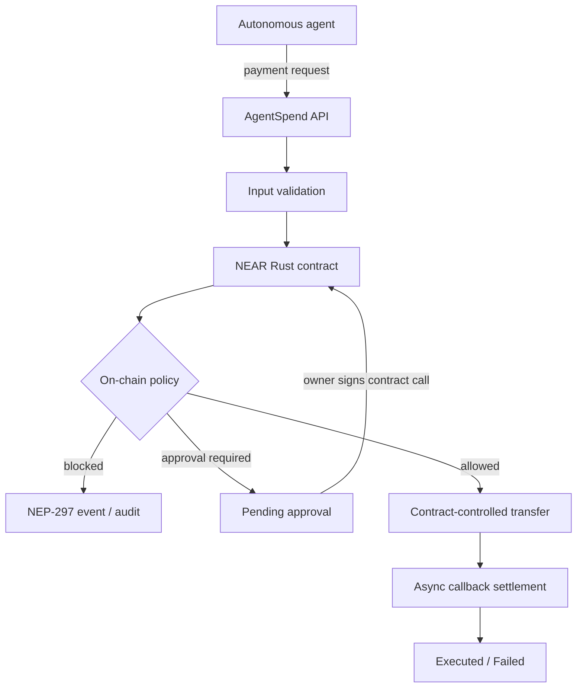

# Architecture

## Intended trust boundary

The contract, not an LLM or backend HTTP handler, is intended to be the authority for fund movement and policy enforcement. The API's simulation adapter is not equivalent to the contract.

## Trust boundaries
- Agent credentials identify an agent; the body must not be trusted for agent identity.
- Backend simulation is informational and must never be described as on-chain execution.
- Owner approvals must be signed by the owner at the NEAR protocol/contract boundary.
- Contract-controlled funds and callbacks determine actual payment settlement.
- Database rows are a cache/UI index, not proof of payment.

## Implemented in this package
- Contract source and Rust/sandbox test sources are present.
- API has a local simulator and rejects TESTNET startup until a real adapter exists.
- API has explicit agent/owner middleware, request validation, rate limiting, structured JSON logs, and a PostgreSQL repository adapter.
- PostgreSQL schema includes transaction history indexes; `PERSISTENCE_MODE=memory` is limited to local demos/tests.
- Frontend is an API-connected Next.js control plane with explicit simulation
  labeling, owner-session authentication, loading/error/empty states, and a
  request evaluation workflow.

## Not verified
The PostgreSQL adapter has not been exercised against a live database in this environment. No live ChainPort adapter, deployment, wallet signing, or testnet receipt is verified by this archive.
